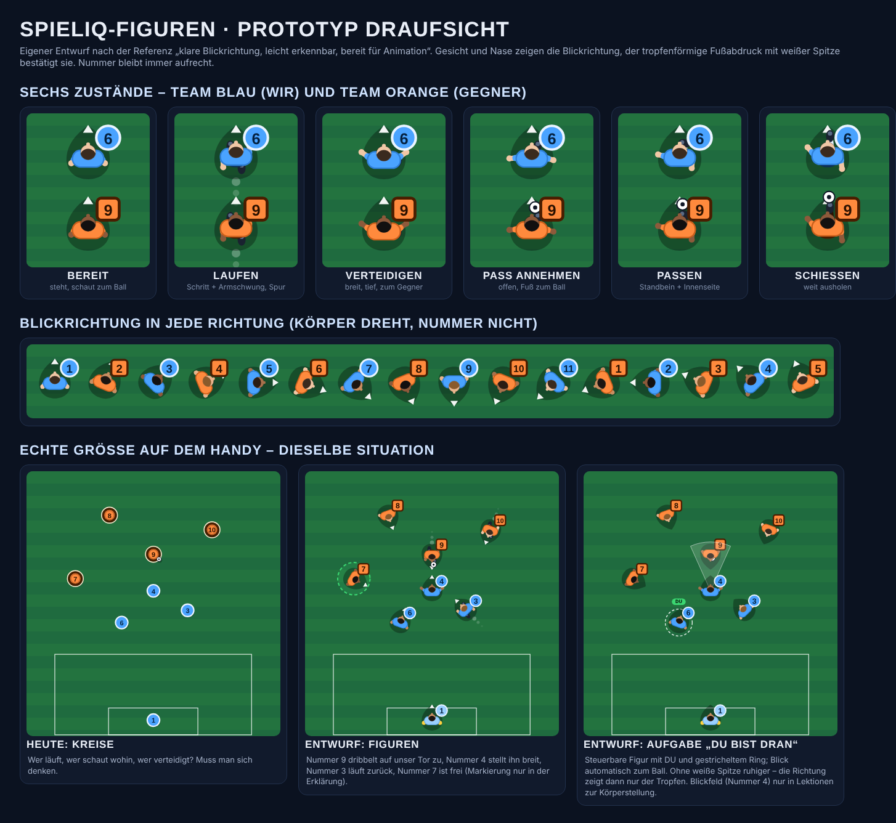

# Spielerfiguren – visuelles System für den Taktik-Simulator

Stand: 30.10.2026 · Status: **Konzept + Prototyp, Entscheidung des Produktverantwortlichen zum Stil ausstehend** · Prototyp: [`prototypen/figuren/`](prototypen/figuren/) · Leistungsmessung: [`prototypen/leistung/`](prototypen/leistung/) · ADR: [0009](../architektur/adr/0009-figuren-als-sprites.md)

## Kurzfassung

| Frage | Entscheidung |
|---|---|
| Wichtigstes Ziel | Ein Kind sieht sofort: Wer gehört zu uns? Wohin schaut wer? Wer läuft? Wer verteidigt? Wer ist frei? Wer bin ich? – **Klarheit vor Realismus.** |
| Ansicht im Simulator | **Draufsicht** (von oben, frei drehbar). Der Fußpunkt ist exakt die Position der Engine. Keine Schrägansicht auf dem Spielfeld. |
| Weitere Ansichten | Vorne, Seite, Hinten, 3/4 von oben – für Erklärfilme, Karten, Avatar, Positionswelten; nicht im Simulator. |
| Zustände | Bereit, Laufen, Verteidigen, Pass annehmen, Passen, Schießen (+ später Dribbeln, Torwart, Jubeln). |
| Technik | **Vorgerenderte Sprites aus einer einzigen Vorlage** (Figur-Rig), im bestehenden SVG-Spielfeld als Bild; Draufsicht wird gedreht, Schrägansichten in 8 Richtungen vorgerendert. Kein Echtzeit-3D. |
| Teams und Nummern | Trikotfarben als „Kits“ (vorab eingefärbt), Nummern immer live als aufrechtes Schild – beliebig viele Nummern ohne neue Grafiken. |
| Rückfall | Die heutigen Kreise bleiben als Modus „Einfach“ (sehr alte Geräte, Editor, Vorliebe der Trainer:innen). |

## 1. Analyse der Referenz – Kernprinzipien

Grundlage: das vom Produktverantwortlichen geschickte Referenzblatt (Team Blau / Team Orange; Posen Bereit, Laufen, Verteidigen, Pass annehmen, Passen, Schießen; Ansichten Vorne, Seite, Hinten, 3/4 oben; Hinweise „Klare Blickrichtung“, „Leicht erkennbar“, „Spielbereit für Animationen“). Es ist Stil- und Richtungsvorlage, kein fertiges Asset. Daraus abgeleitet:

1. **Silhouette zuerst.** Jede Pose ist schon als Umriss eindeutig (Beinstellung, Armhaltung). Farbe und Details kommen danach.
2. **Blickrichtung ausdrücklich.** Gesicht vorne, Schultern quer, Füße zeigen mit. Richtung darf nie erraten werden müssen.
3. **Team = große Farbfläche.** Trikot und Hose tragen die Teamfarbe; zwei klar unterscheidbare Farben (Blau/Orange, wie in unserem Designsystem).
4. **Nummer groß und klar.** Kontraststark, gut lesbar.
5. **Ball separat und kontrastreich**, auch klein erkennbar.
6. **Freundliche, leicht stilisierte Proportionen** (etwas größerer Kopf, klare Formen), sportlich, nicht kindlich-niedlich.
7. **Dieselbe Figur in allen Ansichten.** Vorne, Seite, Hinten und 3/4 müssen erkennbar dieselbe Person sein.
8. **Bereit für Animation.** Gliedmaßen als getrennte Teile, ein gemeinsames Gerüst für alle Posen.

**Was wir bewusst nicht übernehmen:**
- *3/4-Ansicht auf dem Spielfeld:* Perspektive verfälscht Abstände und Linien (Passwege, Abstand zum Gegner), Figuren verdecken sich, und Füße stehen nicht dort, wo die Engine rechnet. In einer Studie mit Nachwuchsfußballern führte die erhöhte Perspektive zu besseren Entscheidungen als die Spielerperspektive; aus Spielerperspektive wurde die richtige Option zwar angeschaut, aber seltener gewählt (C-84, Abstract geprüft). Gezeigt wurden dort gefilmte Szenen von oben, keine gezeichnete Draufsicht – die Übertragung auf unser Spielfeld ist eine Designfolgerung.
- *Schuhdetails, Gesichtsausdruck, Frisuren im Simulator:* Bei 25–35 Pixel Figurengröße unsichtbar oder ablenkend. Interessante, aber für das Lernziel unwichtige Details verschlechterten das Lernen in zwei Meta-Analysen (C-81, C-82, Abstracts geprüft; beim Behalten kleiner bis mittlerer, beim Transfer mittlerer Effekt). Details gehören in die großen Ansichten (Karten, Filme), und auch dort nur, wenn sie etwas zeigen.

## 2. Lernperspektive zuerst: Was muss ein Kind sofort sehen?

Regel: **Ein Merkmal hat genau eine Bedeutung.** Farbe heißt nur „Team“, nie „gut/schlecht“ auf der Figur selbst; Bewertung zeigen weiterhin Ringe mit Symbol und Text.

| Frage des Kindes | Merkmal auf dem Feld | Immer sichtbar? |
|---|---|---|
| Wer gehört zu uns? | Trikotfarbe (Blau/Orange) **und** Form des Nummernschilds (Kreis = wir, Quadrat = Gegner) **und** Stutzenfarbe (hell = wir, dunkel = Gegner) – drei Merkmale, damit es auch bei Farbsehschwäche klappt (WCAG 1.4.1); Legende über dem Feld bleibt | ja |
| Wohin schaut er? | Gesicht und Nase vorne am Kopf, Schultern quer, **tropfenförmiger Fußabdruck mit Spitze in Blickrichtung**; bei Lektionen zur Körperstellung zusätzlich ein helles Blickfeld | Tropfen ja; weiße Spitze nur beim Zuschauen und in der Erklärung; Blickfeld nur in passenden Lektionen |
| Wer läuft? | Schrittpose mit Armschwung (Beine im Takt der echten Geschwindigkeit) + kurze, verblassende Spur hinter der Figur | ja, solange er läuft |
| Wer verteidigt / geht zum Ball? | Breite, tiefe Haltung, Arme leicht seitlich, Blick zum Ballführenden | ja |
| Wer hat den Ball? | Ball am vorderen Fuß in Blickrichtung (nicht mehr starr unten rechts) | ja |
| Wer ist frei? | gestrichelter grüner Bereich um den Spieler („frei“) | **nur** beim Zuschauen, in der Erklärung und in der Rückmeldung – nie in der Aufgabe, sonst ist die Lösung verraten ([Einfach verstehen](einfach-verstehen.md), Abschnitt 2) |
| Wer bin ich / wen darf ich bewegen? | „DU“-Schild und gestrichelter Ring (wie heute) | in Aufgaben |

Ruhe auf dem Feld: kein Gras-Muster auf den Figuren, keine Effekte, Bewegung nur, wenn sie etwas bedeutet. Mit „Weniger Bewegung“ stehen alle Figuren in ihrer Pose still (keine Beinanimation, keine Spur); der Zustand bleibt an der Pose erkennbar.

## 3. Das Figurensystem

### 3.1 Drei Ebenen je Spieler

| Ebene | Inhalt | dreht mit der Blickrichtung? |
|---|---|---|
| Boden | Fußabdruck (Tropfen), Spur, „frei“-Bereich, Auswahl-/Bewertungsring, Blickfeld | Tropfen und Blickfeld ja, Ringe nein |
| Körper | Sprite der Pose (Beine, Hose, Arme, Schultern, Kopf) | ja |
| Info | Nummernschild, „DU“, später Rollen-Symbol | **nein** – Text bleibt immer aufrecht und lesbar |

### 3.2 Anatomie in Draufsicht (Prototyp)

Maße relativ zur Schulterbreite (= 1): Kopf 0,5 (vorne versetzt, Gesicht als heller Halbmond mit Nase vorne), Schultern 1 × 0,55 (größte Fläche, Teamfarbe), Arme mit Ärmelansatz in Teamfarbe, Hose klein, Beine als Stutzen in Teamkontrastfarbe, Schuhe dunkel mit heller Spitze. Gesamtbreite mit Armen ca. 1,5. Der Fußabdruck ist ein Tropfen von ca. 1,4 Schulterbreiten.

**Größe auf dem Handy:** Ziel 30–36 Pixel Gesamtbreite bei einem typischen Ausschnitt (ca. 50 m Breite auf 412 Pixel). Kleiner als ca. 24 Pixel werden Posen unleserlich → dann automatisch einfacher zeichnen (nur Tropfen, Schultern, Kopf, Nummer). Die unsichtbare Trefferfläche bleibt wie heute (etwa 2,1-facher Radius, ≥ 44 Pixel).

### 3.3 Farben (Tokens)

Die Teamfarben kommen aus dem [Designsystem](designsystem.md) (`--team-own`, `--team-opp`, Torwart-Varianten). Neu je Kit: `shirt`, `shirtEdge`, `shorts`, `socks`, `numberInk`, `badgeShape`. Kontrast der Figur zum Rasen ≥ 3 : 1 für Schultern und Nummernschild (rechnerisch prüfen wie bei den heutigen Kreisen).

### 3.4 Vielfalt

Auf dem Feld zurückhaltend: Haut- und Haartöne variieren je Rückennummer aus einer kleinen Palette (5 Töne); das Trikot bleibt die größte Farbfläche, damit das Team auf einen Blick erkennbar bleibt. In den großen Ansichten (Avatar, Karten) dürfen Kinder Aussehen wählen. Die Belege zu Avatar-Ähnlichkeit und Identifikation stammen überwiegend aus Studien mit Erwachsenen und sind gemischt; ein dauerhaft ähnlicher Avatar war in einem Experiment nicht überlegen (C-90, nachgeprüft). Erklärfiguren wirkten in einer Meta-Analyse bei Schüler:innen stärker als bei Studierenden (C-91). Wahlmöglichkeit im Avatar ist deshalb eine **Annahme** zur Motivation, kein belegter Lernhebel – Realismus bringt nach heutigem Stand jedenfalls keinen Vorteil.

## 4. Zustände

| Zustand | Bedeutung | Erkennbar an (Draufsicht) | Auslöser in der Engine (Vorschlag) | Animation |
|---|---|---|---|---|
| **Bereit** | steht spielbereit | Füße nebeneinander, Arme locker, Blick zum Ball | keine Bewegung, keine Ballaktion | Standbild (optional leichtes Wippen, 2 Bilder, standardmäßig aus) |
| **Laufen** | bewegt sich | Schrittstellung, Gegenarm schwingt, Spur | Geschwindigkeit über Schwelle (Annahme: 1 m/s) | Schleife 8 Bilder; Bildwechsel nach zurückgelegter Strecke (Schrittlänge), damit die Beine zur Geschwindigkeit passen und Zeitlupe/Pause stimmen |
| **Verteidigen** | stellt den Ballführenden / geht zum Ball | breit, tief, Arme seitlich, Blick zum Ballführenden; bei langsamer Bewegung Seitschritte | verteidigende Mannschaft, Abstand zum Ballführenden unter der Druckdistanz des Bewegungsmodells (`pressureDistance`, siehe [Engine](../konzept/engine.md)) oder Rolle „zum Ball gehen“ aus der Aufgabe | Standbild bzw. Seitschritt-Schleife 6 Bilder |
| **Pass annehmen** | Ball kommt zu ihm | offen zum Ball, ein Fuß vor, Arme zur Balance | Ball fliegt zu ihm (letzte 0,4 s vor Ankunft) bis kurz nach Ankunft | einmalig 4 Bilder |
| **Passen** | spielt den Ball | Standbein neben dem Ball, Spielbein mit Innenseite | Pass-Ereignis im Skript bzw. in der Konsequenz-Simulation | einmalig 5 Bilder um den Abspielzeitpunkt |
| **Schießen** | schießt aufs Tor | weit ausgeholt, Durchschwung | Schuss-Ereignis | einmalig 6 Bilder |

Später: **Dribbeln** (Laufen mit Ball am Fuß, Ball vor dem Fuß in Laufrichtung), **Torwart bereit** (breit, Hände vorne, Handschuhe), **Jubeln** (nur für die Folge „Tor!“ und sparsam – es soll belohnen, nicht ablenken).

**Blickrichtung (Regeln):** läuft → Laufrichtung; steht → zum Ball (Spieler beobachten den Ball); Ballführender → Bewegungs- bzw. Spielrichtung; Verteidiger im Druck → zum Ballführenden; Szenarien können die Blickrichtung je Spieler festlegen (für Lektionen wie „offen stehen“). Drehungen werden begrenzt (Annahme: höchstens etwa eine halbe Drehung pro Sekunde wie beim Menschen), damit Figuren nicht springen.

## 5. Ansichten

| Ansicht | Wofür | Wo im Produkt | Richtungen | Phase |
|---|---|---|---|---|
| **Draufsicht (taktisch)** | Positionen, Abstände, Passwege, Blickrichtung | Simulator, Aufgaben, Konsequenz-Animation, Trainerbereich | stufenlos gedreht (eine Grafik je Pose/Bild) | 1 |
| **3/4 von oben** | Szene „erleben“: Einstieg in eine Mission, Erklärfilm-Nahaufnahmen, Startseite | Missionsstart, Erklärfilme, Teaser | 8 Richtungen vorgerendert | 3 |
| **Vorne** | Figur vorstellen, Avatar, „Das bist du“ | Profil/Avatar, Onboarding, Ergebnisbildschirm | 1 | 3 |
| **Seite** | Körperstellung erklären (offen/geschlossen, Annahme mit dem richtigen Fuß) | Erklärfilme, Karten | links/rechts (gespiegelt) | 3 |
| **Hinten** | Rückennummer, „Positionskarte“ (6er, Außen, Stürmer) | Positionswelten, Mannschaftsübersicht | 1 | 3 |

Im Simulator gibt es bewusst nur die Draufsicht: Abstrakte Darstellungen (z. B. Spieler als Punkte) reichen in Studien zur Mustererkennung im Fußball für das Erkennen von Spielerbeziehungen (C-85), und 3D-, VR- oder 360°-Darstellungen verbesserten Entscheidungen in den gefundenen Studien nicht; in einer davon lernte auch die Gruppe mit herkömmlicher Taktiktafel gegenüber der Kontrollgruppe (C-87, C-88, C-89; am 30.10.2026 nachgeprüft).

## 6. Technikentscheidung: 2,5D, Sprites oder Echtzeit-3D?

| Kriterium | 2,5D live (Vektorteile, im Browser animiert) | **Sprites aus einer Vorlage** | Echtzeit-3D (z. B. three.js) |
|---|---|---|---|
| Leistung (eigene Messung¹: 22 Spieler + Ball, Pixel-7-Emulation, CPU ÷6) | 41 Bilder/s, 43 % Bilder > 20 ms, 235 SVG-Knoten | **60 Bilder/s, ≈ 1 % > 20 ms, 59 Knoten** | nicht gemessen; WebGL-Kontext, GPU-Last, Akku |
| Ladegröße | klein (Code) | Bildatlas je Team (Ziel ≤ 150 KB, Schätzung) | Bibliothek grob 150–200 KB gz plus Modelle 1–3 MB (Schätzung, nicht gemessen) |
| Gleiche Figur in allen Ansichten | schwer (jede Ansicht neu zeichnen) | ja, wenn alle Ansichten aus derselben Vorlage gerendert werden | ja |
| Lesbarkeit klein | gut | gut (Pixel-genau für kleine Größen optimierbar) | Kantenflimmern, Beleuchtung lenkt ab |
| Barrierefreiheit, Tests | DOM-Elemente | DOM-Elemente (wie heute: fokussierbar, `data-player-id`) | Canvas – zusätzliche unsichtbare Ebene nötig |
| Lernwirkung | – | – | kein belegter Vorteil (C-87–C-89) |
| Aufwand | mittel, Pflege teuer | Vorlage einmal bauen, danach Skript | hoch (Modell, Rig, Shader, Kamera) |

¹ [`prototypen/leistung/run.cjs`](prototypen/leistung/run.cjs), Chromium mit CPU-Drosselung, am 30.10.2026 zweimal gemessen; kein echtes Altgerät – Messung auf einem günstigen Android-Gerät steht aus.

**Entscheidung:** Sprites. Die Figur wird **einmal** als Vorlage gebaut (Gerüst mit Posen; entweder als 3D-Modell mit flacher, comicartiger Beleuchtung in Blender oder als 2D-Vektor-Rig). Ein Skript rendert daraus alle Posen, Bilder, Ansichten und Teamfarben als Bildatlanten. Die App zeigt nur noch Bilder an und dreht sie in der Draufsicht. So bleibt die Laufzeit so leicht wie heute, und Echtzeit-3D bleibt später möglich (gleiche Vorlage), falls es einen Lernvorteil gibt.

## 7. Empfehlung für die Next.js-App

- **Rendering bleibt SVG** ([ADR 0002](../architektur/adr/0002-svg-rendering.md)): neue Komponente `PlayerFigure` in `@spieliq/pitch` mit denselben Eigenschaften wie `PlayerToken` (Trefferfläche, Tastatur, ARIA, `data-player-id`) plus `pose`. Der Körper ist ein `<image>` im Atlas-Ausschnitt (verschachteltes `<svg viewBox>` je Figur), gedreht per `transform`; Nummernschild und „DU“ als SVG-Text darüber.
- **Assets:** `apps/web/public/figures/<kit>-<look>@2x.webp` (und @3x) mit Atlas-Beschreibung (`frames.json`: Ausschnitt, Ankerpunkt = Fußmitte, Punkt für die Rückennummer in den großen Ansichten). Inhaltsadressierte Dateinamen → dauerhaft cachebar (wie bei der Sprachausgabe). Vorladen nur auf Missionsseiten.
- **Erster Schritt ohne Grafiker:** Die Vorlage für die Draufsicht kann als Vektor-Rig im Code entstehen (wie der Prototyp). Ein Build-Skript rastert sie mit dem vorhandenen Chromium/Playwright zu Atlanten. Für die großen Ansichten (Vorne, Seite, Hinten, 3/4) empfiehlt sich eine Illustratorin bzw. ein 3D-Artist nach diesem Dokument.
- **Leistungsbudget (Abnahme):** 22 Figuren + Ball bei CPU ÷6 im Mittel ≥ 55 Bilder/s und ≤ 5 % Bilder > 20 ms; Atlas je Team ≤ 150 KB; kein Layout-Sprung beim Laden (Kreise als Platzhalter, bis der Atlas da ist).

## 8. Skalierung: Teams, Nummern, Varianten

- **Kit** (Trikot): `{ id, shirt, shirtEdge, shorts, socks, numberInk, badgeShape, pattern }` – heute `blau`, `orange`, `blau-torwart`, `orange-torwart`. Ein neues Kit (z. B. Vereinsfarben) = Eintrag + Skriptlauf, keine Code-Änderung am Renderer. Muster (Streifen, Ringel) nur in großen Ansichten; auf dem Feld zählt die Fläche.
- **Look** (Haut/Haar): kleine Palette; auf dem Feld nach Rückennummer verteilt, im Avatar wählbar.
- **Nummer:** immer live als Text (beliebige Nummern, auch Kürzel wie „TW“) – im Simulator als aufrechtes Schild, in der Rückenansicht als Text auf dem Rückennummer-Punkt des Atlas.
- **Atlanten nur bei Bedarf:** Es werden nur Kombinationen erzeugt, die Inhalte tatsächlich verwenden (Draufsicht: 4 Kits × 5 Looks), große Ansichten erst mit Phase 3.
- **Mannschaftsseite:** „wir“ ist immer Blau, der Gegner immer Orange – unabhängig vom echten Vereinstrikot. Das bleibt die wichtigste Konstante für die Kinder.

## 9. Einbindung in den Simulator

- **Engine (rein, testbar):** Neue Funktion `derivePoses(timeline, t)` bzw. `derivePosesStatic(board)` liefert je Spieler `{ facing, action, phase }`. Grundlage sind Skript-Ereignisse (laufen, dribbeln, passen, schießen), Ballflug und Abstände (Druckdistanz). Deterministisch, damit Zeitlupe, Pause und Zurückspulen genau dieselben Bilder zeigen.
- **Szenarioformat v1 (abwärtskompatibel):** optionales Feld `facing` je Spieler im Board (Grad, 0 = Angriffsrichtung) für Lektionen zur Körperstellung. Spiegeltest der Content-Prüfung um Blickrichtung erweitern.
- **Aufgaben (Platzieren):** Gesetzte Spieler schauen automatisch zum Ball; wer nah genug am Ballführenden steht, geht in Verteidigungshaltung. So sehen Kinder schon beim Platzieren, ob „ihr“ Spieler den Gegner stellt.
- **Konsequenz-Animation:** Ballweg, Annahme, Pass, Schuss werden mit den passenden Posen gezeigt – Grundlage für die geplante Ball-Simulation (Ball läuft zum Gegner, Spieler läuft durch und schießt).
- **Beschriftungen für Screenreader** um den Zustand ergänzen, knapp: „Nummer 4, Blau, verteidigt, schaut zu Nummer 9“.
- **Modus „Einfach“:** Kreise wie heute; automatisch, wenn der Atlas nicht lädt.

## 10. Umsetzungsplan

| Phase | Inhalt | Abnahme |
|---|---|---|
| **0 – erledigt (30.10.2026)** | Analyse, Konzept, Prototyp Draufsicht, Leistungsmessung | dieses Dokument, Bild oben |
| **1 – Blickrichtung und Zustände in der Engine** | `derivePoses`, optionales `facing` im Szenarioformat, Regeln aus Abschnitt 4 | Unit-Tests: steht → schaut zum Ball; läuft → Laufrichtung; Passfenster; Spiegelinvarianz; keine Sprünge > Drehgrenze |
| **2 – Figuren-Renderer Draufsicht** | Vektor-Rig im Code, Build-Skript für Atlanten, `PlayerFigure`, Ball am Fuß in Blickrichtung, Spur, „frei“-Bereich in Erklärungen | Leistungsbudget (automatisierter Playwright-Lauf mit CPU-Drosselung), Kontrastprüfung, E2E-Screenshots Handy/Desktop |
| **3 – Einbau in alle Missionen** | Figuren als Standard, „Einfach“-Schalter, „Weniger Bewegung“, ARIA-Texte | bestehende E2E-Tests grün, neue Tests für Zustände |
| **4 – Ball-Simulation mit Posen** | Folge-Animation: Passweg zum Gegner, Abfangpunkt, Durchlaufen + Schuss + „Tor!“, „So wäre es richtig“ | Content-Tests: jede Fehlerart hat eine sichtbare Folge |
| **5 – Große Ansichten** | Vorne/Seite/Hinten/3/4 aus derselben Vorlage (Grafiker:in), Avatar-Wahl, Positionskarten, Figuren im Erklärfilm mit KI-Stimme | Stil-Abnahme durch den Produktverantwortlichen |
| **6 – Test mit Kindern** | Vergleich Kreise vs. Figuren mit 3–5 Kindern der Zielgruppe: „Wohin schaut Nummer 4?“, „Wer ist frei?“, „Wer läuft?“ – richtig/falsch und Zeit | Figuren nur als Standard, wenn sie mindestens gleich gut verstanden werden |

## 11. Offene Entscheidungen (Produktverantwortlicher)

1. **Stil:** Passt die Richtung des Prototyps (freundlich, flach, Draufsicht mit Tropfen-Fußabdruck)? Wenn ja, Phase 1–3 ohne Grafiker:in.
2. **Große Ansichten:** Grafiker:in bzw. 3D-Artist beauftragen (Budget) oder später?
3. **Vielfalt auf dem Feld:** Haut-/Haartöne variieren (Vorschlag) oder alle Spieler eines Teams gleich?

## 12. Quellen und Annahmen

- C-81, C-82 (verführerische Details), C-84 (Vogelperspektive), C-85 (abstrakte Darstellungen), C-87, C-88, C-89 (3D/VR/360°), C-90, C-91 (Figuren, Ähnlichkeit, pädagogische Agenten) – [Register C](../recherche/quellen/C-sport-und-lernwissenschaft.md); am 30.10.2026 im Original nachgeprüft (meist Abstract, teils Volltext), Korrekturen stehen in den Einträgen.
- Eine Studie, die realistische mit stilisierten Spielerfiguren direkt vergleicht, wurde nicht gefunden (Register C, Synthese 7). Die Wahl der Figuren ist deshalb eine **Designfolgerung**, die im Test mit Kindern (Phase 6) überprüft wird.
- Alle Schwellen (Laufschwelle, Drehgrenze, Pixelgrößen, Leistungsbudget) sind **Annahmen**.
- Die Figuren sind ein eigener Entwurf; keine Grafiken von Verbänden oder Spielen übernommen.
